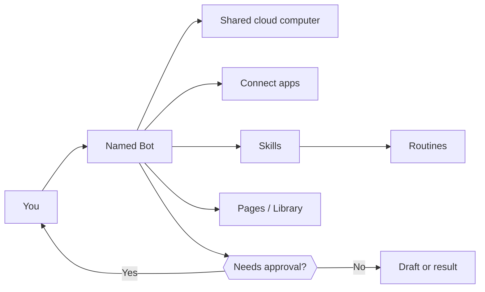
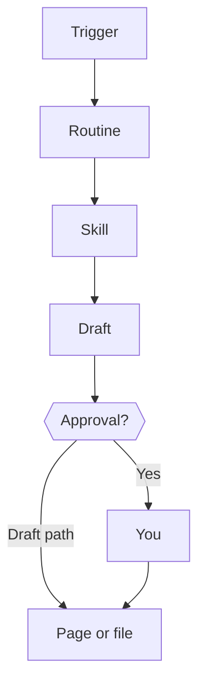

# Awesome Grok Bot

<a id="awesome-grok-bot"></a>

<p align="center">
  
</p>

<p align="center">
  <a href="https://awesome.re"></a>
  <a href="https://github.com/bigibyte/awesome-grok-bot/stargazers"></a>
  
  
  
  
</p>

<p align="center">
  <a href="#tldr-30-seconds"></a>
  <a href="docs/learning-path.md"></a>
  <a href="#quick-start-checklist-your-first-10-minutes"></a>
  <a href="docs/workflows.md"></a>
  <a href="docs/comparisons.md"></a>
  <a href="docs/faq.md"></a>
</p>

> [!TIP]
> If this guide helps you, please give it a [star](https://github.com/bigibyte/awesome-grok-bot) so more people can find it.

---

## TL;DR (30 seconds)

**Grok Bot** ([x.ai/bot](https://x.ai/bot)) is a desktop/mobile app where you message named **Bots** (AI teammates). They share a **persistent cloud computer** (browser, files, terminal), use **Connect apps**, learn **skills**, run **routines**, and build **Pages**. Work can continue with your laptop closed. Approvals stop risky steps. This repo is a beginner-friendly awesome list + guides with verified links only. Not an official SpaceXSI / xAI / Cursor page.

<p align="right"><a href="#awesome-grok-bot">Back to top</a></p>

---

## Contents

- [TL;DR (30 seconds)](#tldr-30-seconds)
- [Who is it for](#who-is-it-for)
- [What is Grok Bot?](#what-is-grok-bot)
- [How it works (diagram)](#how-it-works-diagram)
- [Why people find it powerful](#why-people-find-it-powerful)
- [I want to... (quick pick)](#i-want-to-quick-pick)
- [Learning path](#learning-path)
- [Quick start checklist (your first 10 minutes)](#quick-start-checklist-your-first-10-minutes)
- [Full capabilities](#full-capabilities)
- [Guides in this repo](#guides-in-this-repo)
- [Starter bots](#starter-bots)
- [Use case ideas by role](#use-case-ideas-by-role)
- [Videos](#videos)
- [Articles and docs](#articles-and-docs)
- [Community](#community)
- [Fair comparisons](#fair-comparisons)
- [Limits](#limits)
- [Cheat sheet](#cheat-sheet)
- [Recent updates](#recent-updates)
- [FAQ](#faq)
- [How to share / cite](#how-to-share--cite)
- [Star history](#star-history)
- [Contributing](#contributing)
- [License](#license)

---

## Who is it for

| Who | Start |
|-----|-------|
| Founders / chiefs of staff | [Who is it for](docs/who-is-it-for.md) · [Starter bots](docs/starter-bots.md) |
| Sales / recruiting / marketing / ops | [Use case recipes](docs/use-case-recipes.md) |
| Eng / PMs | [Feature examples](docs/feature-examples.md) · Cloud Agents |
| Complete beginners | [Learning path](docs/learning-path.md) · [Getting started](docs/getting-started.md) |

<p align="right"><a href="#awesome-grok-bot">Back to top</a></p>

---

## What is Grok Bot?

Grok Bot is an app where you create named **Bots**. Think of each Bot as a teammate with a job. You message it like a colleague. It does multi-step work across websites and connected apps. It comes back when it needs your OK.

Your account gets a **persistent cloud computer** with a browser, files, and a terminal. All Bots on your account share that one computer. Grok Bot is **not** Grok chat on grok.com.

**Platforms:** macOS, Windows, Linux, iPhone, Android. Sources: [overview](https://docs.x.ai/grok-bot/overview), [FAQ](https://docs.x.ai/grok-bot/faq), [product](https://x.ai/bot).

<p align="center">
  
</p>

<details>
<summary><strong>Click: plain-English analogy</strong></summary>

<br>

Imagine a remote teammate with a laptop in the cloud. You text a job. They open sites, save files, and draft messages. Risky steps (send, buy, delete) ping you first.

</details>

<p align="right"><a href="#awesome-grok-bot">Back to top</a></p>

---

## How it works (diagram)





> [!NOTE]
> Brand look in this repo: near-black and white, matching public Grok / x.ai monochrome surfaces ([brand guidelines](https://x.ai/legal/brand-guidelines); logo color commonly cited as `#000000`). We do not alter official logos.

<p align="right"><a href="#awesome-grok-bot">Back to top</a></p>

---

## Why people find it powerful

1. Real cloud computer, not only chat drafts. [overview](https://docs.x.ai/grok-bot/overview)
2. Work continues when your laptop is closed. [FAQ](https://docs.x.ai/grok-bot/faq)
3. Setup is a message. [overview](https://docs.x.ai/grok-bot/overview)
4. Many Bots coordinate. [overview](https://docs.x.ai/grok-bot/overview)
5. Skills + routines. [skills and routines](https://docs.x.ai/grok-bot/skills-routines-and-automations)
6. Approvals + Auto Review. [approvals](https://docs.x.ai/grok-bot/approvals-security-and-privacy)
7. Same teammates on phone and desktop. [get started](https://cursor.com/docs/grok-bot/get-started)

<p align="right"><a href="#awesome-grok-bot">Back to top</a></p>

---

## I want to... (quick pick)

| I want to... | Go here |
|--------------|---------|
| Learn in order | [Learning path](docs/learning-path.md) |
| Install in 10 minutes | [Quick start](#quick-start-checklist-your-first-10-minutes) |
| See every feature with examples | [Feature examples](docs/feature-examples.md) |
| Copy prompts by role | [Prompt library](docs/prompt-library.md) |
| Copy ready-made Bot jobs | [Starter bots](docs/starter-bots.md) |
| Build workflows | [Workflows](docs/workflows.md) |
| Keyboard shortcuts | [Shortcuts](docs/keyboard-shortcuts.md) |
| Fix a mistake | [Troubleshooting](docs/troubleshooting.md) |
| Know hard limits | [Limits](docs/limits.md) |
| Compare tools | [Comparisons](docs/comparisons.md) |

<p align="right"><a href="#awesome-grok-bot">Back to top</a></p>

---

## Learning path

Full checklists: [docs/learning-path.md](docs/learning-path.md)

- **Beginner:** install, one safe task, skim limits, one prompt
- **Intermediate:** second Bot, skill, connector, Page, Disabled routine
- **Power user:** multi-bot workflow, feature map, comparisons, Vault habits

<p align="right"><a href="#awesome-grok-bot">Back to top</a></p>

---

## Quick start checklist (your first 10 minutes)

- [ ] Open [x.ai/bot](https://x.ai/bot) or [cursor.com/download/bot](https://cursor.com/download/bot) and install
- [ ] Sign in with Cursor
- [ ] Name a Bot after one job and ask it to remember the rules
- [ ] Send a safe task that changes nothing outside chat
- [ ] Grant only needed access
- [ ] Later: Connect apps → save a skill → read [safety](docs/safety-privacy.md)

<details>
<summary><strong>Example first message</strong></summary>

<br>

```
You are my Research Bot.
Never send email, never post, never buy, never delete without asking.
Summarize the attached doc in 5 bullets, list dates and open questions, do not change the file.
```

</details>

<p align="right"><a href="#awesome-grok-bot">Back to top</a></p>

---

## Full capabilities

<p align="center">
  
</p>

See [docs/capabilities.md](docs/capabilities.md) and [docs/feature-examples.md](docs/feature-examples.md) for the full map with sources (Bots, computer, Connect apps, skills, Teach a task, routines, Pages/Library, agent email, voice, group chats, Vault, Auto Review, Cloud Agents, settings).

<p align="right"><a href="#awesome-grok-bot">Back to top</a></p>

---

## Guides in this repo

| Guide | Best for |
|-------|----------|
| [Getting started](docs/getting-started.md) | First win |
| [Step by step](docs/step-by-step.md) | First week |
| [Learning path](docs/learning-path.md) | Beginner → power |
| [Who is it for](docs/who-is-it-for.md) | Role fit |
| [Capabilities](docs/capabilities.md) | Feature map |
| [Feature examples](docs/feature-examples.md) | Concrete examples |
| [Limits](docs/limits.md) | What it cannot do |
| [Bots](docs/bots-and-teammates.md) | Multi-bot |
| [Starter bots](docs/starter-bots.md) | Copy-ready jobs |
| [Skills](docs/skills.md) / [Routines](docs/routines.md) | How + when |
| [Workflows](docs/workflows.md) | End-to-end flows |
| [Connectors](docs/connectors.md) | Apps + email |
| [Computer](docs/computer-and-browser.md) | Shared PC |
| [Memory](docs/memory.md) / [Pages](docs/pages.md) | Context + Library |
| [Keyboard shortcuts](docs/keyboard-shortcuts.md) | Desktop chords |
| [Prompt library](docs/prompt-library.md) | By role |
| [Use case recipes](docs/use-case-recipes.md) | Role starters |
| [Comparisons](docs/comparisons.md) | Vs other agents |
| [Troubleshooting](docs/troubleshooting.md) | Mistakes + fixes |
| [Cheat sheet](docs/cheat-sheet.md) / [Glossary](docs/glossary.md) / [FAQ](docs/faq.md) | Reference |
| [Safety](docs/safety-privacy.md) | Approvals + secrets |
| [Resources](docs/resources.md) | All links + thumbs |
| [Changelog](docs/recent-updates.md) | Dated notes |

<p align="right"><a href="#awesome-grok-bot">Back to top</a></p>

---

## Starter bots

Copy-ready roles (Research, Inbox, Ops, Sales Prep, Calendar EA, Bot Boss): [docs/starter-bots.md](docs/starter-bots.md).

<p align="right"><a href="#awesome-grok-bot">Back to top</a></p>

---

## Use case ideas by role

<p align="center">
  
</p>

Official starters: [use cases](https://docs.x.ai/grok-bot/use-cases). Recipes: [docs/use-case-recipes.md](docs/use-case-recipes.md).

<p align="right"><a href="#awesome-grok-bot">Back to top</a></p>

---

## Videos

| Thumb | Video |
|-------|-------|
|  | [Alex Finn setup](https://www.youtube.com/watch?v=vrgO4D_mUlA) |
|  | [Charlie 2026 tutorial](https://www.youtube.com/watch?v=q1IwR88mhaA) |
|  | [Louis setup](https://www.youtube.com/watch?v=EO7e2PGMI1E) |
|  | [Beginner automate](https://www.youtube.com/watch?v=_JYh3tgJzVw) |

<p align="right"><a href="#awesome-grok-bot">Back to top</a></p>

---

## Articles and docs

| Card | Resource |
|------|----------|
|  | [Product page](https://x.ai/bot) |
|  | [Introducing Grok Bot](https://x.ai/news/introducing-grok-bot) |
|  | [Docs overview](https://docs.x.ai/grok-bot/overview) |
|  | [Get started](https://docs.x.ai/grok-bot/get-started) |
|  | [Grok Bot 101](https://x.ai/bot/guides/grok-bot-101) |
|  | [Use cases](https://docs.x.ai/grok-bot/use-cases) |
|  | [Pages help](https://cursor.com/help/grok-bot/pages) |
|  | [Learn Cursor](https://www.learncursor.dev/learn/cursor-agents/grok-bot-setup) |
|  | [Wiki plugins/MCP](https://www.grokbotwiki.com/guides/grok-bot-plugins-mcp) |

Full list: [docs/resources.md](docs/resources.md).

<p align="right"><a href="#awesome-grok-bot">Back to top</a></p>

---

## Community

| Card | Resource |
|------|----------|
|  | [grokbot.run](https://grokbot.run/about/) |
|  | [prompts.chat](https://prompts.chat/bots) |
|  | [DC Hub MCP](https://dchub.cloud/connect?utm_source=awesome-grok-bot&utm_medium=listing&utm_campaign=directories) (data-center and energy data for agents; free to start) |

<p align="right"><a href="#awesome-grok-bot">Back to top</a></p>

---

## Fair comparisons

<p align="center">
  
</p>

Short table + sources: [docs/comparisons.md](docs/comparisons.md). No invented prices.

<p align="right"><a href="#awesome-grok-bot">Back to top</a></p>

---

## Limits

Hard boundaries (shared computer, no model picker, Pages rollout, attachment caps, voice chat rules, and more): [docs/limits.md](docs/limits.md).

<p align="right"><a href="#awesome-grok-bot">Back to top</a></p>

---

## Cheat sheet

[docs/cheat-sheet.md](docs/cheat-sheet.md) · [docs/keyboard-shortcuts.md](docs/keyboard-shortcuts.md)

<p align="right"><a href="#awesome-grok-bot">Back to top</a></p>

---

## Recent updates

[docs/recent-updates.md](docs/recent-updates.md) (changelog with sources).

<p align="right"><a href="#awesome-grok-bot">Back to top</a></p>

---

## FAQ

<details>
<summary><strong>Same as Grok chat?</strong></summary>

<br>

No. [FAQ](https://docs.x.ai/grok-bot/faq).

</details>

<details>
<summary><strong>Works with laptop closed?</strong></summary>

<br>

Yes for cloud turns and routines. [FAQ](https://docs.x.ai/grok-bot/faq).

</details>

<details>
<summary><strong>Model picker?</strong></summary>

<br>

No. [FAQ](https://docs.x.ai/grok-bot/faq).

</details>

More: [docs/faq.md](docs/faq.md) · [docs/troubleshooting.md](docs/troubleshooting.md).

<p align="right"><a href="#awesome-grok-bot">Back to top</a></p>

---

## How to share / cite

- Star and share the repo: `https://github.com/bigibyte/awesome-grok-bot`
- Org: [https://github.com/bigibyte](https://github.com/bigibyte)
- Formal citation file: [CITATION.cff](CITATION.cff)
- Suggest a resource or correction: use the issue templates under `.github/ISSUE_TEMPLATE/`

```
MD Kawsar / bigibyte (2026). Awesome Grok Bot (community guide). https://github.com/bigibyte/awesome-grok-bot
```

<p align="right"><a href="#awesome-grok-bot">Back to top</a></p>

---

## Star history

> [!TIP]
> If this guide helps you, please give it a [star](https://github.com/bigibyte/awesome-grok-bot) so more people can find it.

<p align="center">
  <a href="https://star-history.com/#bigibyte/awesome-grok-bot&Date">
    
  </a>
</p>

---

## Contributing

See [CONTRIBUTING.md](CONTRIBUTING.md). Verified links only. Simple English. No em dashes. PR template in `.github/PULL_REQUEST_TEMPLATE.md`.

## License

[CC0 1.0 Universal](LICENSE)

---

<p align="center">
  <a href="https://github.com/bigibyte/awesome-grok-bot/stargazers"></a>
</p>

<p align="center"><strong>If this guide helps you, please give it a [star](https://github.com/bigibyte/awesome-grok-bot) so more people can find it.</strong></p>

<p align="center"><a href="https://github.com/bigibyte">https://github.com/bigibyte</a></p>

<p align="center"><em>If this saved you time, a star helps others find it.</em></p>
