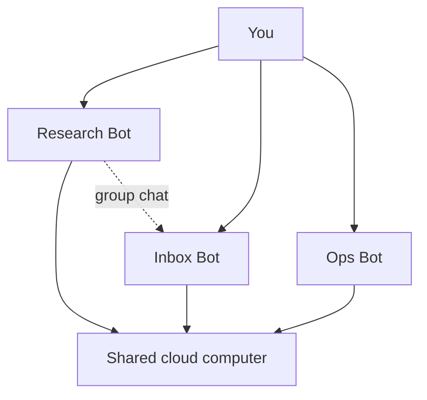

# Bots and teammates

> [!TIP]
> If this guide helps you, please give it a [star](https://github.com/bigibyte/awesome-grok-bot) so more people can find it.

  

## What a Bot is

A Bot is a named teammate with a job. You talk to it in a chat. It can use the shared cloud computer and connected apps. It can ask for approval before risky steps. Source: [overview](https://docs.x.ai/grok-bot/overview).

## Tips that work well

1. **One job per Bot.** Research Bot, Inbox Bot, Ops Bot.
2. **Write the job in the first message.** Ask it to remember the rules.
3. **Use group chats** when two Bots need to hand work off. Source: [overview](https://docs.x.ai/grok-bot/overview).
4. **Share templates carefully.** Sharing gives a copy of the Bot design, not your computer, logins, or private memory. Source: [FAQ](https://docs.x.ai/grok-bot/faq).

> [!IMPORTANT]
> All Bots on your account share one cloud computer. A file or browser login used by one Bot can be reached by another. Source: [computer and apps](https://docs.x.ai/grok-bot/computer-and-apps).

## Tagging on X

You can tag @bot on X to hand a post to your main Bot. Region limits apply. Source: [overview](https://docs.x.ai/grok-bot/overview).

## Starter Bot roles

| Bot name | Job | First constraint |
|----------|-----|------------------|
| Research | Summarize sources | Never post or email |
| Inbox | Draft replies | Never send without OK |
| Ops Digest | Daily summary | Draft only in Slack |
| Sales Prep | Account brief | Do not contact prospects |

---

| | | |
|:---|:---:|---:|
| ← [Limits](limits.md) | [README](../README.md) · [Back to top](#top) | [Starter bots](starter-bots.md) → |

> [!TIP]
> If this guide helps you, please give it a [star](https://github.com/bigibyte/awesome-grok-bot) so more people can find it.

<a href="https://github.com/bigibyte">https://github.com/bigibyte</a>

<em>If this saved you time, a star helps others find it.</em>

