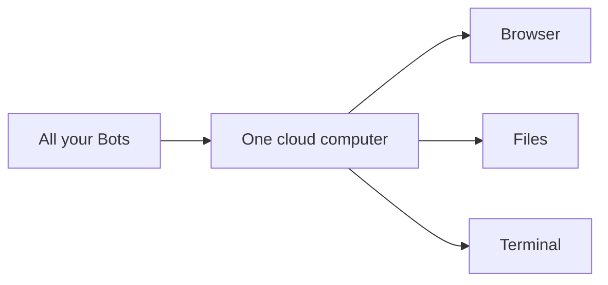

# Computer and browser

> [!TIP]
> If this guide helps you, please give it a [star](https://github.com/bigibyte/awesome-grok-bot) so more people can find it.

Your Grok Bot account gets a **persistent cloud computer** with a browser, filesystem, and terminal. All Bots on the account share that one computer. Source: [computer and apps](https://docs.x.ai/grok-bot/computer-and-apps).

## Why that matters

- Work can continue after you close your laptop. Source: [FAQ](https://docs.x.ai/grok-bot/faq).
- Files and browser sessions are **not isolated** between Bots.
- Prefer Connect apps for structured tools; use the browser for sites without a clean plugin.

## Practical checklist

- [ ] Keep a tidy folder layout for reports and downloads
- [ ] Log out of sites you do not want every Bot to reach
- [ ] Use Vault / 1Password / Secure Form for secrets when available
- [ ] For long research, ask for a **Page** so the result stays in Library

> [!NOTE]
> Claude's computer use research preview controls **your** Mac or Windows desktop and needs that machine awake. Grok Bot's computer is in the **cloud**. Details: [comparisons.md](comparisons.md).

---

| | | |
|:---|:---:|---:|
| ← [Connectors](connectors.md) | [README](../README.md) · [Back to top](#top) | [Memory](memory.md) → |

> [!TIP]
> If this guide helps you, please give it a [star](https://github.com/bigibyte/awesome-grok-bot) so more people can find it.

<a href="https://github.com/bigibyte">https://github.com/bigibyte</a>

<em>If this saved you time, a star helps others find it.</em>

