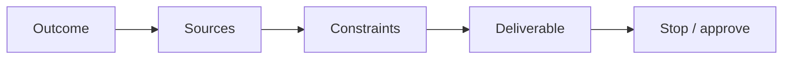

# Prompting tips

> [!TIP]
> If this guide helps you, please give it a [star](https://github.com/bigibyte/awesome-grok-bot) so more people can find it.

Simple rules that match how Grok Bot works.

## Five parts

1. **Outcome** - what done looks like
2. **Sources** - where to look
3. **Constraints** - what never to do
4. **Deliverable** - file, Page, draft, table
5. **Stop** - ask before send / post / buy / delete

## Prefer verbs that stay safe

- Draft, summarize, compare, list, propose
- Avoid: send, post, purchase, delete (unless you really mean it and will approve)

> [!TIP]
> If you already saved a skill, call it by name: "Run skill Weekly competitor brief for Acme."

## One job at a time

Multi-step is fine. Multiple unrelated jobs in one message is not.

## Correct in chat

When the Bot is wrong, correct it and ask it to remember. That is cheaper than rewriting the whole job later.

Full copy-ready prompts: [prompt-library.md](prompt-library.md).

---

| | | |
|:---|:---:|---:|
| ← [Prompt library](prompt-library.md) | [README](../README.md) · [Back to top](#top) | [Use case recipes](use-case-recipes.md) → |

> [!TIP]
> If this guide helps you, please give it a [star](https://github.com/bigibyte/awesome-grok-bot) so more people can find it.

<a href="https://github.com/bigibyte">https://github.com/bigibyte</a>

<em>If this saved you time, a star helps others find it.</em>

