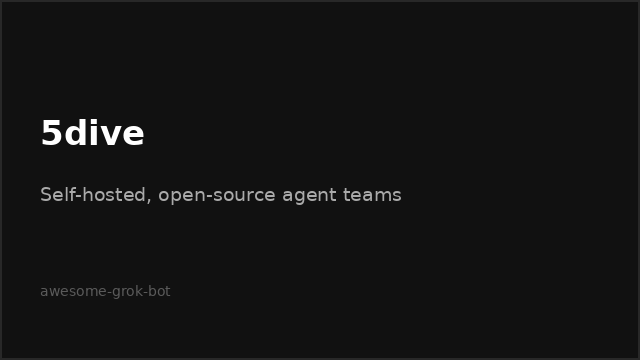

# Verified resources

> [!TIP]
> If this guide helps you, please give it a [star](https://github.com/bigibyte/awesome-grok-bot) so more people can find it.

  

## Official

| Card | Link |
|------|------|
|  | [x.ai/bot](https://x.ai/bot) |
|  | [Introducing Grok Bot](https://x.ai/news/introducing-grok-bot) |
|  | [Overview](https://docs.x.ai/grok-bot/overview) |
|  | [Get started](https://docs.x.ai/grok-bot/get-started) |
|  | [Use cases](https://docs.x.ai/grok-bot/use-cases) |
|  | [Grok Bot 101](https://x.ai/bot/guides/grok-bot-101) |
|  | [Pages help](https://cursor.com/help/grok-bot/pages) |

Also: [FAQ](https://docs.x.ai/grok-bot/faq) · [computer and apps](https://docs.x.ai/grok-bot/computer-and-apps) · [skills and routines](https://docs.x.ai/grok-bot/skills-routines-and-automations) · [approvals](https://docs.x.ai/grok-bot/approvals-security-and-privacy) · [chat and collaboration](https://docs.x.ai/grok-bot/chat-and-collaboration) · [files and results](https://docs.x.ai/grok-bot/files-and-results) · [settings](https://docs.x.ai/grok-bot/settings-and-notifications) · [security](https://docs.x.ai/grok-bot/security) · [teams](https://docs.x.ai/grok-bot/teams-and-enterprises) · [changelog](https://x.ai/changelog/bot) · [Grok Bot for Work](https://x.ai/bot/guides/grok-bot-for-work) · [brand guidelines](https://x.ai/legal/brand-guidelines) · [cursor get started](https://cursor.com/docs/grok-bot/get-started) · [download](https://cursor.com/download/bot)

## Community

| Card | Link |
|------|------|
|  | [Learn Cursor](https://www.learncursor.dev/learn/cursor-agents/grok-bot-setup) |
|  | [grokbot.run](https://grokbot.run/about/) |
|  | [Wiki plugins/MCP](https://www.grokbotwiki.com/guides/grok-bot-plugins-mcp) |
|  | [prompts.chat](https://prompts.chat/bots) |
|  | [grokguide.si](https://grokguide.si/) (Chinese, step-by-step tutorials) |

Inbox workflow posts: [botskills.sh](https://botskills.sh/blog/grok-bot-to-inbox-triage) · [Boterly](https://boterly.si/templates/inbox-triage) · [Charlie Automates](https://charlieautomates.com/blog/grok-bot-tutorial-ai-email-management/) · [WSMBD](https://whatshouldmybotdo.com/guides/grok-bot-email-routines)

## Videos

| Thumb | Video |
|-------|-------|
|  | [Alex Finn](https://www.youtube.com/watch?v=vrgO4D_mUlA) |
|  | [Charlie](https://www.youtube.com/watch?v=q1IwR88mhaA) |
|  | [Louis](https://www.youtube.com/watch?v=EO7e2PGMI1E) |
|  | [Beginner automate](https://www.youtube.com/watch?v=_JYh3tgJzVw) |

## Comparison sources

| Card | Link |
|------|------|
|  | [Claude Dispatch/computer use](https://claude.com/resources/articles/dispatch-and-computer-use) · [Claude Code docs](https://code.claude.com/docs/en/computer-use) |
|  | [ChatGPT agent help](https://help.openai.com/en/articles/11752874-chatgpt-agent) |
|  | [Manus features](https://manus.im/features) · [Studio](https://manus.im/docs/features/desktop) |
|  | [5dive README](https://github.com/5dive-ai/5dive) |

---

| | | |
|:---|:---:|---:|
| ← [Safety and privacy](safety-privacy.md) | [README](../README.md) · [Back to top](#top) | [Recent updates](recent-updates.md) → |

> [!TIP]
> If this guide helps you, please give it a [star](https://github.com/bigibyte/awesome-grok-bot) so more people can find it.

<a href="https://github.com/bigibyte">https://github.com/bigibyte</a>

<em>If this saved you time, a star helps others find it.</em>

