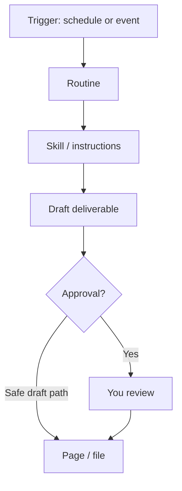

# Routines

> [!TIP]
> If this guide helps you, please give it a [star](https://github.com/bigibyte/awesome-grok-bot) so more people can find it.

  

Routines run skills (or instructions) on a **schedule** or when an **event** fires. Source: [skills and routines](https://docs.x.ai/grok-bot/skills-routines-and-automations).

## Common trigger types

Official and community docs mention schedules plus events such as Slack messages, GitHub activity, email, and webhooks. Always confirm the exact list in your app, since trigger catalogs can grow.

## Safe routine checklist

- [ ] Start with **draft only** outputs
- [ ] Keep approvals on for send / post / buy / delete
- [ ] Name routines after the outcome
- [ ] Test once manually before you trust the schedule

<strong>Example: Monday research digest</strong>

 

- Trigger: every Monday 09:00 your local time
- Skill: competitor brief
- Deliverable: Page + Slack draft
- Stop: do not post the Slack message until approved

<strong>Example: Inbox triage</strong>

 

- Trigger: new email (if available) or hourly check
- Skill: triage labels + draft replies
- Stop: never send

More recipes: [use-case-recipes.md](use-case-recipes.md).

---

| | | |
|:---|:---:|---:|
| ← [Skills](skills.md) | [README](../README.md) · [Back to top](#top) | [Workflows](workflows.md) → |

> [!TIP]
> If this guide helps you, please give it a [star](https://github.com/bigibyte/awesome-grok-bot) so more people can find it.

<a href="https://github.com/bigibyte">https://github.com/bigibyte</a>

<em>If this saved you time, a star helps others find it.</em>

