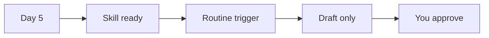

<a id="top"></a>
# Step by step: first week with Grok Bot

> [!TIP]
> If this guide helps you, please give it a [star](https://github.com/bigibyte/awesome-grok-bot) so more people can find it.

A longer beginner path. Each day builds on the last.

## Day-by-day checklist

<details open>
<summary><strong>Day 1: install and one safe task</strong></summary>

<br>

- [ ] Install from [x.ai/bot](https://x.ai/bot)
- [ ] Sign in with Cursor
- [ ] Name your first Bot after a job (Research, Inbox, Ops Digest)
- [ ] Send a task that only produces a reply
- [ ] Correct the Bot and ask it to remember

</details>

<details>
<summary><strong>Day 2: one connected app</strong></summary>

<br>

- [ ] Open **Connect apps**
- [ ] Connect one tool you already use
- [ ] Ask the Bot to **draft** something
- [ ] Keep the rule: do not send until you say so
- [ ] Approve or edit the draft yourself

</details>

<details>
<summary><strong>Day 3: skills</strong></summary>

<br>

- [ ] When a task goes well: "Save this as a skill named X."
- [ ] Or use **Teach a task** (up to 10 minutes). Source: [skills and routines](https://docs.x.ai/grok-bot/skills-routines-and-automations)
- [ ] Run the skill once more to prove it

</details>

<details>
<summary><strong>Day 4: computer and files</strong></summary>

<br>

- [ ] Ask the Bot to save a report as a file
- [ ] Or extract facts into a Page
- [ ] Remember: all Bots share one computer. Source: [computer and apps](https://docs.x.ai/grok-bot/computer-and-apps)

</details>

<details>
<summary><strong>Day 5: a small routine</strong></summary>

<br>

- [ ] Pick something weekly or daily that only needs a draft
- [ ] Create a **routine** with a schedule or trigger
- [ ] Keep approvals on for anything that leaves the Bot



</details>

<details>
<summary><strong>Day 6: second Bot</strong></summary>

<br>

- [ ] Create a second Bot with a different job
- [ ] Use a group chat if they need to hand work off
- [ ] Do not assume secrets are isolated between Bots

</details>

<details>
<summary><strong>Day 7: review safety</strong></summary>

<br>

- [ ] Read [safety-privacy.md](safety-privacy.md)
- [ ] Check Auto Review and approval settings
- [ ] Use Vault / 1Password / Secure Form when available

</details>

## Prompt template for every new job

```
Outcome: what done looks like
Sources: where to look
Constraints: what never to do
Deliverable: file, Page, or draft text
Stop: ask me before send / post / buy / delete
```

More templates: [prompt-library.md](prompt-library.md).

---

| | | |
|:---|:---:|---:|
| ← [Getting started](getting-started.md) | [README](../README.md) · [Back to top](#top) | [Learning path](learning-path.md) → |

> [!TIP]
> If this guide helps you, please give it a [star](https://github.com/bigibyte/awesome-grok-bot) so more people can find it.

<p align="center"><a href="https://github.com/bigibyte">https://github.com/bigibyte</a></p>

<p align="center"><em>If this saved you time, a star helps others find it.</em></p>
