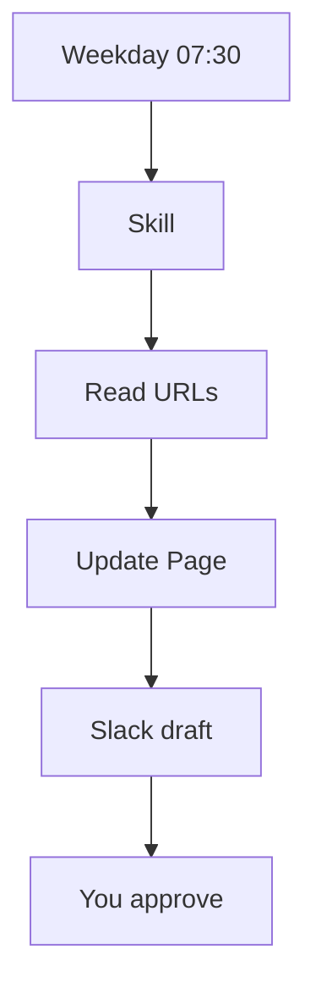
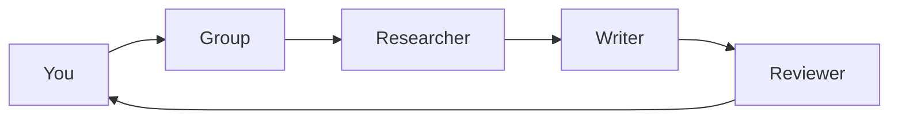
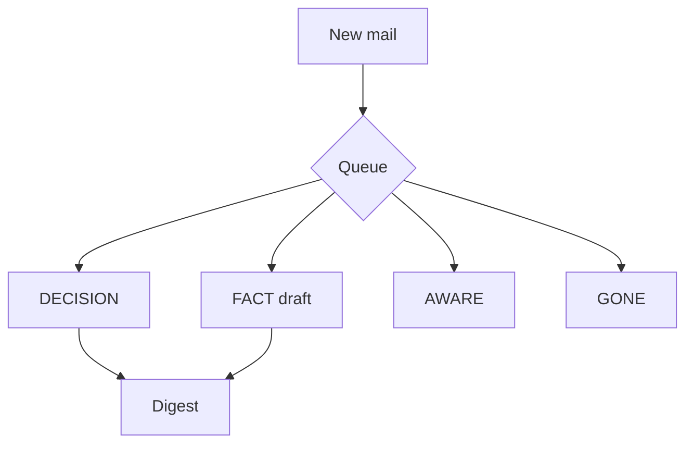
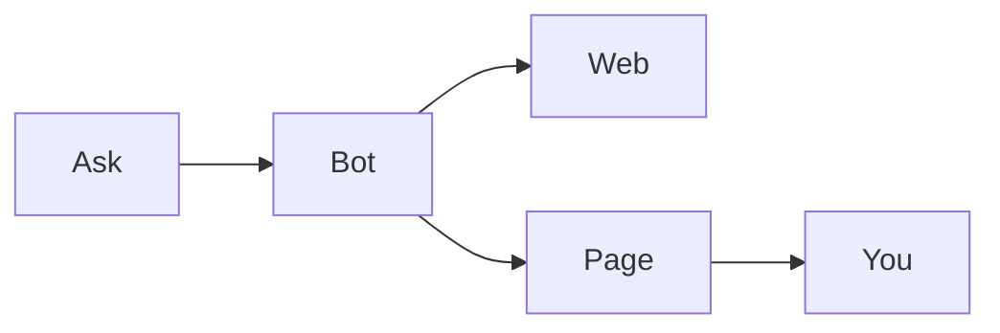
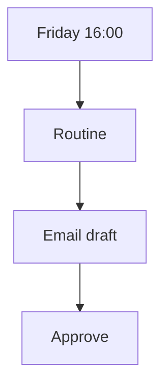

<a id="top"></a>
# Workflows

> [!TIP]
> If this guide helps you, please give it a [star](https://github.com/bigibyte/awesome-grok-bot) so more people can find it.

<p align="center">
  
</p>

## Quick pick

| I want... | Jump |
|-----------|------|
| Official multi-bot work setup | [Community](#community-workflows-verified) |
| Daily news digest | [Example 1](#example-1-daily-news-digest-routine) |
| Multi-bot social pipeline | [Example 2](#example-2-social-post-pipeline-multi-bot) |
| Inbox triage | [Example 3](#example-3-inbox-triage) |
| Research to Page | [Example 4](#example-4-research-to-page-report) |
| Email reminders | [Example 5](#example-5-scheduled-reminders-by-email) |

## Community workflows (verified)

| Source | What they share |
|--------|-----------------|
| [Grok Bot for Work](https://x.ai/bot/guides/grok-bot-for-work) | Inbox Manager, Calendar EA, Intel Scout, Bot Boss + prompts |
| [botskills.sh inbox triage](https://botskills.sh/blog/grok-bot-to-inbox-triage) | Four queues, draft-only, twice-daily schedule |
| [Boterly Inbox Triage](https://boterly.si/templates/inbox-triage) | Skills + paused routines; never sends |
| [Charlie Automates email](https://charlieautomates.com/blog/grok-bot-tutorial-ai-email-management/) | Morning sweep, drafts first |
| [WSMBD email routines](https://whatshouldmybotdo.com/guides/grok-bot-email-routines) | `mail.grokbot.com` triggers |

> [!IMPORTANT]
> Prefer official [skills and routines](https://docs.x.ai/grok-bot/skills-routines-and-automations) on conflict.

## Example 1: Daily news digest routine

**Goal:** Weekday morning Page update + Slack draft (no post).

**Setup:** Bot `News Digest` → skill `Weekday news digest` → routine weekdays 07:30, create Disabled, test, Enable.

```
You are News Digest. Sources only: <url1>, <url2>, <url3>.
Update Page "Morning digest". Prepare Slack draft. Never post. Never invent sources.
```



## Example 2: Social post pipeline (multi-bot)

**Setup:** Bots Researcher, Writer, Reviewer → group chat (`Cmd/Ctrl+Shift+N`).

```
@Researcher gather sources and link claims.
@Writer draft LinkedIn + X posts.
@Reviewer list blocking issues only.
Do not publish. Stop for my approval.
```



Source: [chat and collaboration](https://docs.x.ai/grok-bot/chat-and-collaboration).

## Example 3: Inbox triage

**Setup:** Connect Gmail → skills Triage + Digest → routines 08:15 and 15:30 weekdays, Disabled first.

```
Classify each new message: DECISION, FACT, AWARE, GONE.
Draft only for FACT. Never send or delete. Digest DECISION first.
```



## Example 4: Research to Page report

```
Research <topic>. Official docs first.
Make Page "<topic> brief" with summary, claims+links, risks, open questions.
Ask before sharing outside Library.
```



Source: [files and results](https://docs.x.ai/grok-bot/files-and-results).

## Example 5: Scheduled reminders by email

Routine Friday 16:00 emails you from `mail.grokbot.com`; leave as draft.

```
Every Friday 16:00, email me Subject: Weekly wrap checklist.
Body: 5 bullets from my open tasks Page. Never BCC others. Draft for approval.
```



---

| | | |
|:---|:---:|---:|
| ← [Routines](routines.md) | [README](../README.md) · [Back to top](#top) | [Connectors](connectors.md) → |

> [!TIP]
> If this guide helps you, please give it a [star](https://github.com/bigibyte/awesome-grok-bot) so more people can find it.

<p align="center"><a href="https://github.com/bigibyte">https://github.com/bigibyte</a></p>

<p align="center"><em>If this saved you time, a star helps others find it.</em></p>
